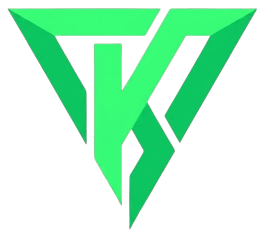

  
  <h1>Academia Krypton</h1>
  
Sistema integrado de gestão de academias

  

    <a href="https://projetoacademiakrypton.onrender.com/">Aplicação web</a> ·
    <a href="https://academia-krypton.gitbook.io/academia-krypton-docs/">Documentação oficial</a> ·
    <a href="https://projetoacademiakrypton.onrender.com/api-docs.html">Referência da API</a>
  

## Sobre o projeto

A Academia Krypton é uma plataforma web desenvolvida como projeto acadêmico do curso de Desenvolvimento de Software Multiplataforma da FATEC Itaquera – Prof. Miguel Reale.

Seu objetivo é digitalizar e centralizar os processos de uma academia, integrando alunos, recepcionistas, personal trainers, nutricionistas e administração em um único ambiente.

## Funcionalidades

- Cadastro, autenticação e controle de acesso por perfil.
- Consulta de planos e unidades, contratação de planos e checkout acadêmico.
- Área do aluno com acompanhamento de atividades, treinos, alimentação e agendamentos.
- Gestão de alunos, atendimentos, agenda e profissionais.
- Elaboração de fichas de treino e planos alimentares personalizados.
- Painel administrativo com indicadores e gerenciamento de contas.
- Processamento assíncrono e notificações internas.

O ambiente público destina-se à demonstração acadêmica. Os pagamentos são simulados, sem cobranças reais.

## Tecnologias

| Camada | Tecnologias |
| --- | --- |
| Frontend | HTML, CSS, JavaScript e Bootstrap |
| Backend | Node.js, Express e API REST |
| Banco de dados | MySQL e Prisma ORM |
| Autenticação | JWT, bcryptjs e Google OAuth 2.0 |
| Integrações | Mercado Pago (teste), QR Code e SMTP |
| Infraestrutura | Render e Oracle Cloud |

## Documentação

A documentação oficial reúne os guias de instalação e configuração, a arquitetura do sistema, os modelos de dados, os requisitos, as regras de negócio e os casos de uso.

- [Documentação oficial — GitBook](https://academia-krypton.gitbook.io/academia-krypton-docs/)
- [Referência interativa da API — Swagger UI](https://projetoacademiakrypton.onrender.com/api-docs.html)
- [Especificação OpenAPI no repositório](public/openapi.json)
- [Guia de configuração local](docs/GUIA-FACULDADE.md)

## Contexto acadêmico

**Instituição:** FATEC Itaquera – Prof. Miguel Reale  
**Curso:** Desenvolvimento de Software Multiplataforma

Projeto desenvolvido em equipe, com aplicação de conceitos de Engenharia de Software, desenvolvimento web e gestão de projetos.
