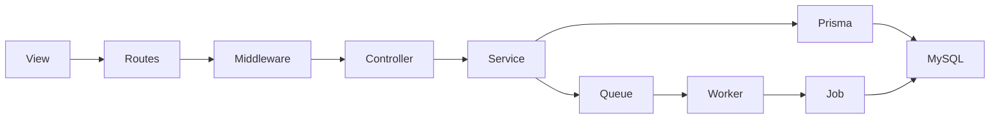
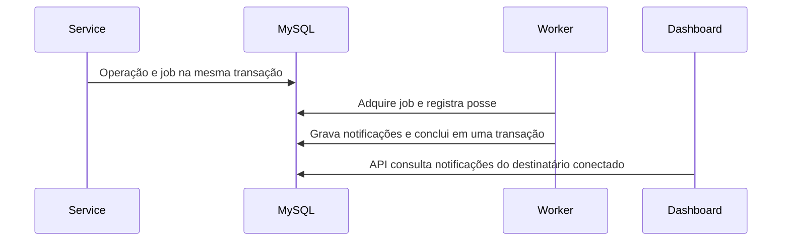

# Perfis profissionais e notificações

## Operação

- Administração usa **Funcionários** para cadastrar recepção, personal e nutricionista, redefinir a senha inicial, alterar o estado da conta e gerenciar vínculos de especialistas. Desativar ou trocar a senha invalida sessões anteriores. O cadastro público atribui o papel aluno.
- Recepção consulta nome, plano, situação, vencimento e unidade. Registra atendimentos e gerencia a agenda. A agenda operacional é compartilhada entre recepcionistas, pois a base atual não atribui uma unidade fixa a cada conta.
- Personal e nutricionista acessam alunos vinculados, suas consultas e somente as fichas que publicaram. O aluno acessa os próprios materiais no painel. Os serviços de personal e nutrição e os novos agendamentos exigem Elite ativo. Básico e Pro mantêm as funcionalidades anteriores, inclusive o registro de frequência de treino.
- Consultas antigas continuam visíveis. Uma consulta sem profissional pode ser cancelada ou concluída conforme seu estado, e precisa ser recriada com vínculo para reagendar.

## Arquitetura

A view usa as APIs Express. O middleware autentica e delimita papéis, os controllers traduzem o resultado para HTTP e os services validam propriedade, benefícios e transições. Prisma persiste no MySQL. No processo síncrono, a operação principal e o enfileiramento compartilham uma transação.

O **job** descreve um evento. A **fila** armazena os eventos e coordena a aquisição. O **worker** consulta a fila e executa um job por vez. A fila usa uma posse com prazo e token exclusivos. Após expiração, outro worker pode adquirir a tarefa. Falhas reagendam com atraso progressivo até cinco tentativas. Conclusão e gravação de notificações usam a mesma transação. O par job e destinatário é único. O payload contém somente IDs, e os erros persistidos são códigos fixos.

Os eventos cobrem agendar, confirmar, cancelar e reagendar consultas e publicar ou atualizar fichas de treino e alimentação. Consultas notificam aluno, especialista e recepção. Materiais notificam aluno e autor, sem conteúdo clínico na mensagem. A central apresenta as últimas 50 notificações e a contagem total de não lidas.

## Migrations e execução

- `20261202_perfis_profissionais` acrescenta campos opcionais e índices à agenda, habilita o papel de recepção e cria vínculos, fichas e atendimentos. Exercícios e refeições são listas JSON validadas pela API. O histórico anterior fica preservado.
- `20261203_notificacoes_jobs` cria `jobs` e `notificacoes`. As chaves de idempotência e os índices cobrem aquisição, recuperação e contagem de não lidas.

Em desenvolvimento, use um MySQL local. Configure `KRYPTON_WORKER_NOTIFICACOES=1` e opcionalmente `KRYPTON_WORKER_INTERVALO_MS` (padrão 5000). Execute `npm run worker` para o processo independente, ou `npm start` com a flag para integrar ao Express. Use uma dessas formas por instalação para evitar consultas redundantes. O worker usa concorrência unitária, reaproveita o Prisma, respeita o pool serial e aguarda o job corrente no encerramento. O demonstrativo hospedado recusa a ativação. Em produção, só o oficial com a política TLS acadêmica aprovada pode habilitá-lo.

No Render gratuito, o processo integrado depende do serviço web estar ativo. O repouso da instância atrasa as notificações até que a aplicação volte a processar a fila. Execute essa modalidade como entrega eventual, sem requisito de horário exato. Os jobs e as notificações persistem no MySQL.

Para publicar, valide as duas migrations em restauração descartável, confira o backup e aplique-as em janela autorizada na instância Oracle com o usuário de migrations restrito ao localhost. Use o Prisma e o schema da revisão aprovada. Mantenha a conta de aplicação com DML e o Build/Start livres de migrations. Faça o deploy do SHA compatível e verifique papéis e notificações antes de habilitar o worker. Um rollback de código preserva as tabelas adicionadas. [Limites do Render gratuito](https://render.com/docs/free)

Lembretes, envio de e-mail e exportação PDF ficam para evoluções. O worker atual entrega notificações internas.

## Teste local reproduzível

Em Linux com Python 3, MySQL 8 e o Prisma Client gerado, execute `npm run test:integration:profissionais`. O roteiro inicia seu próprio MySQL em um diretório descartável, desabilita TCP e verifica o socket antes de qualquer escrita. Testa a aplicação das migrations em banco novo e a atualização da base de 11 migrations com um registro legado. Em seguida, exercita as APIs, autorização, persistência e concorrência do worker com dados fictícios. O roteiro usa o servidor descartável mesmo quando já existe outro MySQL local.
